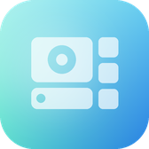

<p align="center"><strong>English</strong> · <a href="README.zh-CN.md">简体中文</a></p>

<div align="center">
  
  <h1>HyperMusicCover-Enhanced</h1>
  <p><strong>Big artwork, lyrics and audio visualizers on the HyperOS 4 lock screen.</strong></p>
  <p>
    <a href="https://github.com/Lewewe/HyperMusicCover-Enhanced/releases"></a>
    <a href="https://t.me/HyperMusicCoverEnhanced"></a>
    <a href="https://t.me/HyperMusicCoverEnhancedChannel"></a>
    <a href="LICENSE"></a>
  </p>
</div>

An LSPosed module forked from [HyperMusicCover](https://github.com/zyl6932/HyperMusicCover).

## Features

| | |
| --- | --- |
| 🎨 **Big cover art** | Full-screen artwork with smooth track changes, or your own wallpaper behind it |
| 🕐 **Clock beside the date** | A small clock to the left of the date while the big cover or lyrics are open, kept on the always-on display |
| 🌈 **Moving backdrop** | Artwork colours drift behind the big cover, as a gradient or a mesh gradient |
| 🎤 **Lyrics** | Synced and word-timed lyrics, translation, font packs and effects |
| (・ω・) **Kaomoji companion** | A face that bops to the beat when neither lyrics nor the big cover are up |
| 📊 **Audio visualizer** *(beta)* | Capsule and player bars that follow the music, even at zero volume |
| 📱 **iPhone-ify** *(A/B)* | Hold a capsule for music or another live activity to open an iPhone-style card at the camera, over the other capsules |
| 🎛️ **Player styling** | Artwork shape, backgrounds, materials, colors and scrolling titles |
| 🔔 **Notifications & AOD** | Works with the notification stack, HyperOS and ColorOS-style capsules and always-on display |
| 📲 **Foldables** | The big cover and its backdrop on the Xiaomi MIX Flip, outer screen included |
| ⬆️ **One-tap updates** | A card on Home downloads and installs a new release, then restarts the scope when root is granted |

Full change list: [release notes](https://github.com/Lewewe/HyperMusicCover-Enhanced/releases). This page follows `main`, so some features arrive with the next release.

## Extensions

Optional apps that add to HyperMusicCover-Enhanced.

| | |
| --- | --- |
|  **[HyperCanvas](https://github.com/Lewewe/HyperCanvas)** | Spotify Canvas on your lock screen |
|  **[HyperImmersive](https://github.com/Lewewe/HyperImmersive)** *(alpha)* | StandBy: a full-screen clock, music and widgets while the phone charges on its side |
|  **[HyperRear](https://github.com/Lewewe/HyperRear)** *(alpha)* | Xiaomi 17 Pro series rear screen: one music player for every app, with HMC-E's lyrics and visualizer |
|  **HyperOcean** *(coming soon)* | An OriginOS-style panel for the lower half of the lock screen |

## Install

**Requires:** rooted HyperOS 4 (Android 15+) with LSPosed (modern Xposed API).

1. Download the APK from [Releases](https://github.com/Lewewe/HyperMusicCover-Enhanced/releases) and install it.
2. Enable the module in LSPosed with its recommended scopes, then reboot.
3. Open the app to set it up.

For Spotify Canvas: **Extensions → HyperCanvas → Download**, then follow the steps shown in the app.

For StandBy: **Extensions → HyperImmersive → Download**, then follow the steps shown in the app.

For the rear screen: **Extensions → HyperRear → Download**, then follow the steps shown in the app.

## Feedback

Tested mainly on Xiaomi 17 Pro and Xiaomi MIX Flip. Updates are posted in the [Telegram channel](https://t.me/HyperMusicCoverEnhancedChannel). Ask in the [Telegram group](https://t.me/HyperMusicCoverEnhanced) or [open an issue](https://github.com/Lewewe/HyperMusicCover-Enhanced/issues) with your device, HyperOS version, module version and music app.

## Build

```sh
git clone --recurse-submodules https://github.com/Lewewe/HyperMusicCover-Enhanced.git
cd HyperMusicCover-Enhanced
./gradlew :app:assembleRelease :hyper-canvas:assembleRelease
```

Needs Android SDK 37. HyperMusicCover-Enhanced, HyperCanvas, [HyperImmersive](https://github.com/Lewewe/HyperImmersive) and [HyperRear](https://github.com/Lewewe/HyperRear), which build from their own repositories, must be signed with the same key (`keystore.properties`).

## Credits

- [Lewewe](https://github.com/Lewewe): fork development
- [puhboo](https://github.com/puhboo): lyrics and HyperCanvas renderer contributions
- [zyl6932](https://github.com/zyl6932/HyperMusicCover): original HyperMusicCover
- [juren233 / HyperLyrics-Enhanced](https://github.com/juren233/HyperLyrics-Enhanced): player styling foundation ([details](docs/media-card-customization.md))
- [miuix](https://github.com/compose-miuix-ui/miuix) and the other libraries listed in the app's Credits page
- [Material Design Icons](https://github.com/google/material-design-icons): the music note in the lyrics button's icon (Apache-2.0)

Support development: [Ko-fi](https://ko-fi.com/yzc26623) (international) · [Afdian](https://afdian.com/a/yzc26623) (mainland China) · License: [AGPL-3.0](LICENSE)
